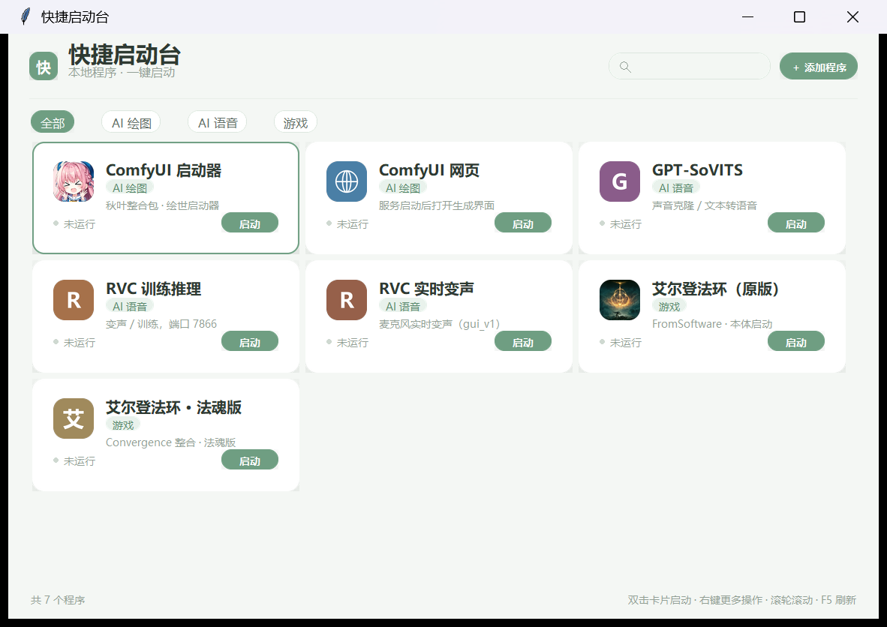

# 快捷启动台（Quick Launcher）

浅色绿色系的本地程序启动器：把常用程序（ComfyUI、GPT-SoVITS、RVC、艾尔登法环……）做成圆角卡片，按分类归拢，点一下就启动。

单文件、纯 Python 标准库 + Pillow，不需要安装框架，双击就能跑。



## 设计

低饱和鼠尾草绿 + 米白/浅灰的浅色主题，扁平、克制、留白充足。

| 用途 | 色值 |
|---|---|
| 主色 | `#6F9E82` |
| 主色（悬停） | `#5B8A6E` |
| 主色浅底 | `#E9F2EC` |
| 页面底色 | `#F4F7F4` |
| 卡片 | `#FFFFFF` |
| 卡片（悬停） | `#E1EDE6` |
| 描边 | `#DCE6DE` |
| 主文字 | `#2E3A32` |
| 次要文字 | `#93A096` |

实现要点：

- **圆角**：所有卡片、按钮、输入框、分段控件都用 Pillow 以 4 倍超采样绘制圆角矩形再降采样，边缘是抗锯齿的，不是 Tk 画布上那种锯齿折线。
- **软阴影**：高斯模糊的圆角投影，按状态（常态/悬停/选中）调整透明度与模糊半径。
- **悬停反馈**：鼠标移入时卡片底色变为浅绿 `#E1EDE6`，阴影同步加深，和页面对比明显。
- **扁平**：没有渐变、没有多余线条，层级靠留白、字重和极浅的描边区分。
- **DPI 自适应**：几何尺寸按 96dpi 设计（`px()` 统一换算），字体用 pt 随 DPI 缩放，所以在 125% / 150% 缩放下同样清晰、比例一致。

## 特性

- **分类筛选**：自动汇总所有条目的分类，顶部生成「全部 / 游戏 / AI 绘图 / AI 语音 …」标签栏，点一下只看该分类；和搜索框可同时生效。
- **三种条目类型**：`exe`（程序 / bat / ps1 / lnk）、`web`（网址，用默认浏览器打开）、`folder`（文件夹，用资源管理器打开）
- **真实图标**：用 Win32 API 从 exe 里提取图标（优先 256px 高清），再裁成圆角方块；网址条目自动绘制地球图标，批处理文件用彩色字母块
- **运行状态检测**：卡片上的圆点和按钮显示「运行中 / 未运行」；对「外壳型」启动器（自己拉起真正的进程后退出）也能跟踪
- **重复启动保护**：已在运行时再点不会重复开一份
- **停止进程**：右键菜单「停止运行」，按进程树结束
- **可视化编辑**：`＋ 添加程序` 弹窗，圆角输入框 + 文件选择器 + 分段选择类型 + 分类字段
- **搜索过滤**：按名称、分类、路径实时筛选
- **记住状态**：窗口尺寸位置、程序清单一律存进 `apps.json`
- **零配置启动**：`apps.json` 不存在时自动生成示例条目

## 环境要求

| 项目 | 要求 |
|---|---|
| 系统 | Windows 10 / 11 |
| Python | 3.9 及以上（自带 tkinter） |
| Pillow | **必需**（圆角、阴影、图标提取都依赖它） |

```powershell
pip install pillow
```

## 快速开始

```powershell
# 1. 直接运行（有控制台窗口，方便看报错）
python launcher.py

# 2. 不想看见黑框就用 pythonw
pythonw launcher.py
```

想做成桌面图标：创建指向 `pythonw.exe` 的快捷方式，参数填 `"<路径>\launcher.py"`，工作目录填脚本所在目录，图标用 `icon.ico`。

首次运行会自动生成 `apps.json`（程序清单）和 `icon.ico`（窗口图标）。

## 操作说明

| 操作 | 效果 |
|---|---|
| 顶部分类标签 | 按分类过滤，「全部」显示所有 |
| 单击卡片 | 选中（绿色描边） |
| **双击卡片** | 启动 |
| 单击卡片右下角「启动」 | 启动 |
| 点击运行中的按钮 | 询问是否结束进程 |
| 右键卡片 | 启动 / 停止运行 / 打开所在文件夹 / 编辑 / 移除 |
| 顶部「＋ 添加程序」 | 新增条目 |
| 顶部搜索框 | 实时过滤 |
| `F5` | 重新读取并刷新列表 |
| 关闭窗口 | 保存清单和窗口位置 |

## 配置文件 `apps.json`

```json
{
  "apps": [
    {
      "name": "艾尔登法环（原版）",
      "path": "D:\\steam\\steamapps\\common\\ELDEN RING\\Game\\eldenring.exe",
      "workdir": "D:\\steam\\steamapps\\common\\ELDEN RING\\Game",
      "args": "",
      "type": "exe",
      "category": "游戏",
      "color": "#8C9AA8",
      "desc": "FromSoftware · 本体启动"
    },
    {
      "name": "ComfyUI 网页",
      "path": "http://127.0.0.1:8188",
      "type": "web",
      "category": "AI 绘图",
      "color": "#8FA9B8",
      "desc": "服务启动后打开生成界面"
    }
  ],
  "window": { "geometry": "1120x760+700+270" }
}
```

| 字段 | 说明 |
|---|---|
| `name` | 卡片标题 |
| `path` | 程序全路径 / 网址 / 文件夹路径 |
| `workdir` | 工作目录，留空则取 `path` 所在目录。**整合包 / 游戏 mod 类程序必须填对**，否则找不到自己的运行时 |
| `args` | 启动参数，空格分隔 |
| `type` | `exe` / `web` / `folder` |
| `category` | 分类，决定卡片上的小标签和顶部分类栏 |
| `color` | 没有可用图标时字母块的颜色，`#RRGGBB` |
| `desc` | 卡片副标题，留空则显示路径 |

## 常见问题

**分类是怎么来的？**
分类不是单独维护的列表，而是从每个条目的 `category` 字段自动去重汇总。改某个条目的分类，顶部的标签栏下次刷新（F5）就会跟着变；没有任何条目的分类自动消失。

**批处理（.bat）条目显示的是字母块而不是图标？**
Windows 给 `.bat` 的统一是同一个通用齿轮图标，看起来比字母块更糊，所以程序刻意对 `.bat/.cmd/.ps1/.vbs` 用彩色字母块。想换图标就把 `type` 改成指向一个 `.lnk` 快捷方式。

**点了「启动」但状态马上又变回「未运行」？**
有些启动器是「外壳」：真正的程序是它拉起的子进程，外壳自己会退出。程序会在启动后 1~5 秒内记录子进程名并按子进程判断运行状态。如果某个程序仍然识别不到，把该程序的 `path` 直接改成真正的进程 exe 即可。

**启动后一闪就没了？**
用 `python launcher.py`（而不是 `pythonw`）跑一次，控制台里会打印错误堆栈；也可以在 `workdir` 填对目录后重试——很多整合包依赖自己的工作目录。

**界面字很大或者很挤？**
程序按系统 DPI 缩放整体尺寸。如果是在远程桌面或多显示器切换后异常，重启一次程序即可让缩放重新生效。

**能启动管理员权限的程序吗？**
不能。需要 UAC 提权的程序请另建 `.lnk` 并勾选「以管理员身份运行」，再把该 `.lnk` 作为条目加入。

**支持 Linux / macOS 吗？**
不支持。图标提取、进程枚举、标题栏配色都是 Windows API；界面部分（tkinter + Pillow）本身是跨平台的。

## 目录结构

```
launcher.py        主程序（单文件）
apps.json          程序清单（自动生成 / 保存，含个人路径，不入库）
apps.example.json  清单格式示例
icon.ico           窗口图标（首次运行自动生成）
screenshot.png     界面截图
```

## License

MIT，见 [LICENSE](LICENSE)。
